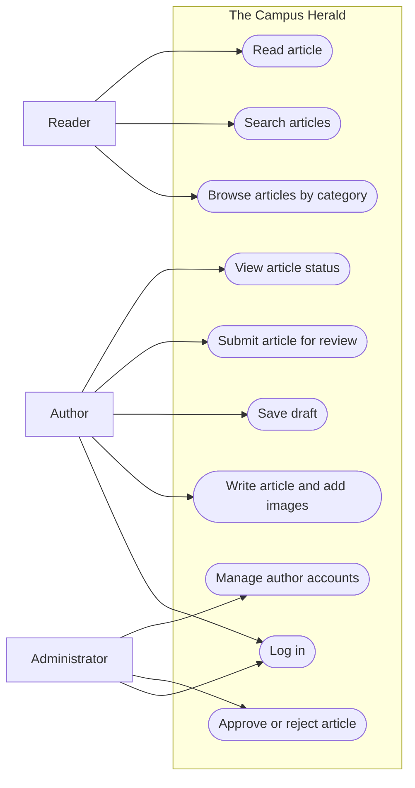
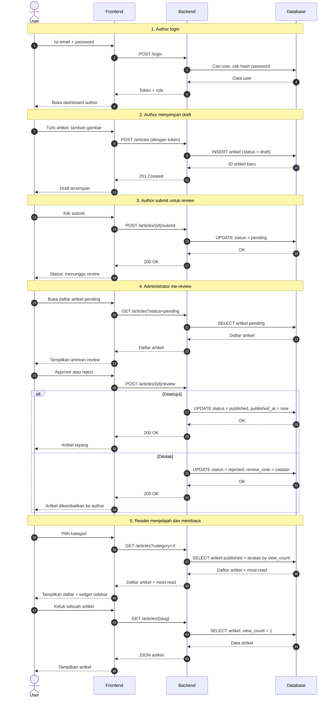
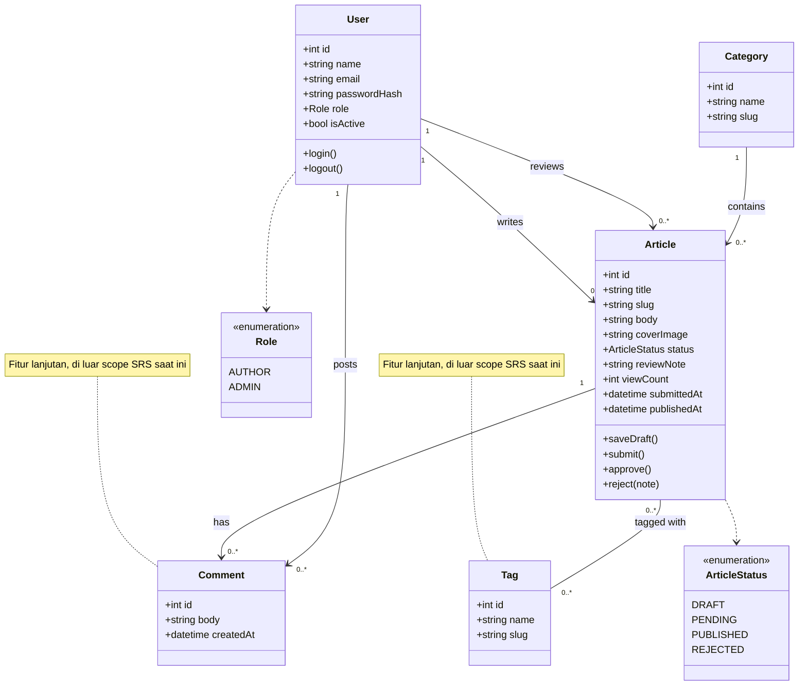
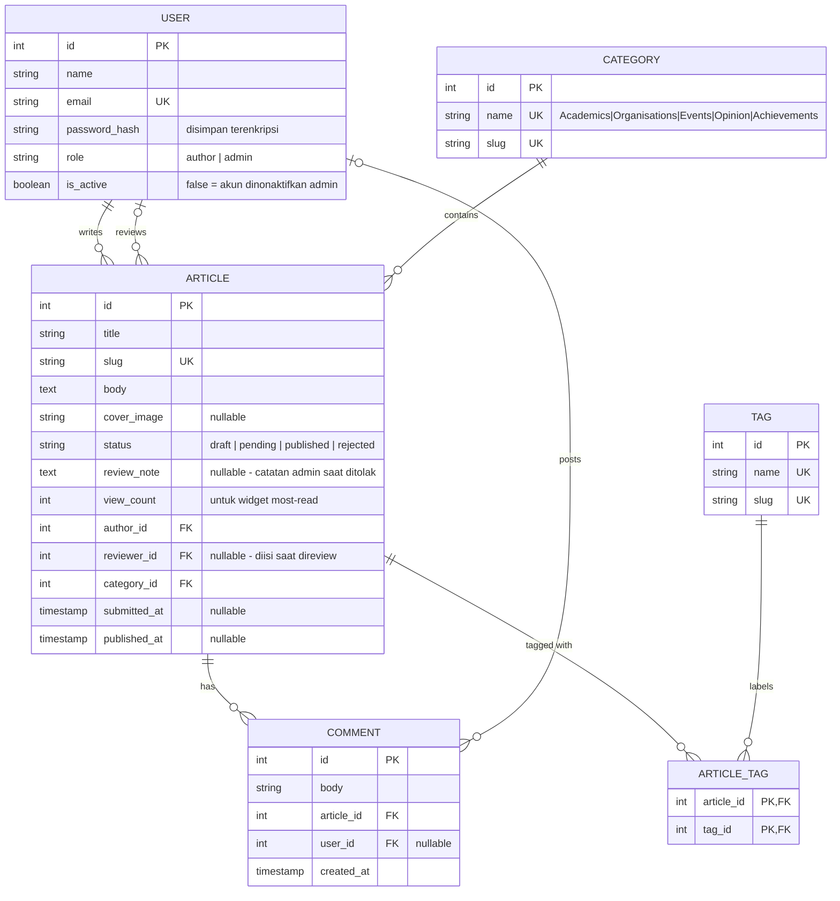
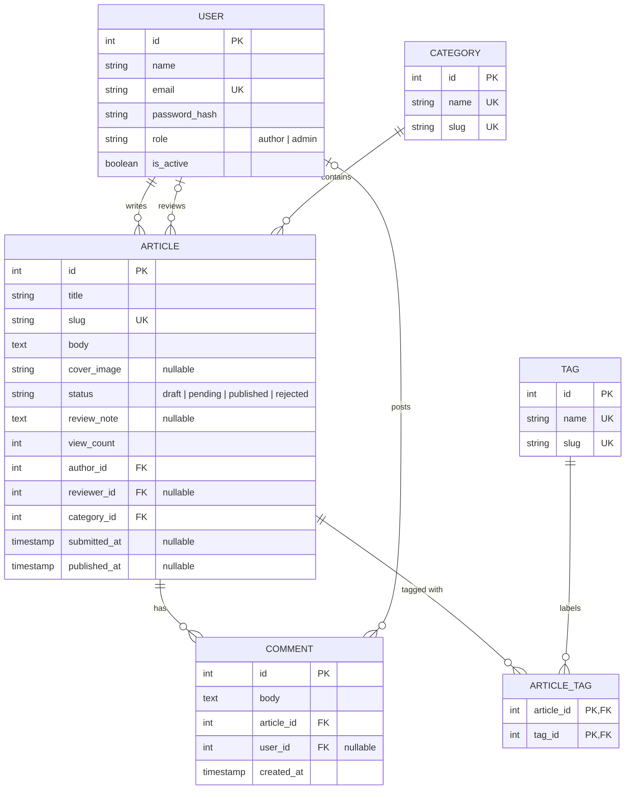

# CMS / Blog — The Campus Herald

> Project document produced with **Meja Gambar**.  
> 21 days · 6/9 stages marked complete · 12/23 prompts filled · 15 October 2026
>
> ⚠️ This document still contains 11 sections that have not been filled in.

## Client Brief

**The Campus Herald** — an internal news portal for students at a single university, run by the student press society, which wants to move off WhatsApp groups and Instagram onto a site of its own.

**User roles:** Reader, Author, Administrator

**Specific client requests**

- Five categories: Academics, Organisations, Events, Opinion, Achievements
- Authors are society members, around ten people, and need a role separate from Administrator
- Every article must be reviewed by an editor before it goes live
- Wants a most-read articles widget in the sidebar

---

## 01 · Research the problem, users, and competitors

`Days 1–2` · `2 days` · **Output:** Research notes and report · ✅ marked complete · 3/3 prompts filled

### The real problem your client faces

- in whatsup sometimes the information is dissepard an the samae as in the instagram
- some of the content is not organized, so the user or the reader, sometimes not choose the topic that tey want to
- all user can acess and write what they want is not secure for the haox information
- the article should be control by the profesioanl first

summary:
The student press society has no central, organised platform to publish campus news. Their content is scattered across WhatsApp groups and Instagram, where posts get buried quickly, cannot be categorised or searched, and are hard to find again later. These platforms also have no editorial workflow: there is no way to separate authors from administrators, and no way to review an article before it is published, so they cannot control the quality of what goes live.

### Comparable products: what works and what does not

whatsapp and instagram, its all good everone could see al the information what they want, and daily using it. but for some hours tha information could be burried away. and user couldn't see that again

portal pres, ussusaly using the category so the studenet could see the all informatiuon that they wannted to. but sometimes the information is to much nad not easy to read them, and hard to organized by 10 people

word press, we usualy could using this as the editable front, but for some role ist hard to build the complex one using this

Conclusion: The Campus Herald should keep the simplicity and speed of social media, adopt the category navigation and archive of news sites, and use a WordPress-style review workflow, but with a much simpler interface.

### What you learned about the users

A. Reader

Readers are students of the university who currently get campus news from WhatsApp groups and Instagram. (From the brief)
They want to browse news by the category they are interested in. (From the brief: five categories)
They mostly read on their phones, so the layout must be easy to scan on a small screen. (Assumption)
They want to search for older articles, which is not possible on WhatsApp. (Assumption)
They do not want to create an account just to read. (Assumption)

B. Author

Authors are around ten members of the student press society. (From the brief)
They are not technical, so the writing editor must be simple. (Assumption)
They want to format their articles with headings, bullet points, and numbered lists. (Assumption)
They want to attach images to their articles. (Assumption)
They want to save drafts and see the status of each article: draft, waiting for review, published, or rejected. (Assumption)
They cannot publish on their own; every article goes to review first. (From the brief)

C. Administrator

The administrator also acts as the editor who reviews articles. (Assumption: the brief mentions an editor but lists no separate editor role)
They must approve every article before it goes live. (From the brief)
They want to reject an article or send it back with notes for the author. (Assumption)
They want to see all articles and their details in one place. (Assumption)
They want to manage author accounts, including adding and removing members as the society changes each year. (Assumption)

---

## 02 · Requirements analysis

`Days 3–4` · `2 days` · **Output:** Functional and non-functional requirements · ✅ marked complete · 2/2 prompts filled

### Functional requirements (FR-01, FR-02, …)

A. Reader
- can browse article by category
- can search for article

B. Author
- can wtite article add image and save as a draf
- can submit article for review

C. administrator
- can approve or reject article tat write by the author
- can add an remove acount author

### Non-functional requirements (NFR-01, NFR-02, …)

Performance	Pages load in under 3 seconds on a mobile connection
Usability	An author can publish their first article without training
Responsiveness	The layout works on phone, tablet, and desktop
Security	Only logged-in authors and administrators can reach the dashboard; passwords are stored encrypted

---

## 03 · Formal documentation

`Day 5` · `1 day` · **Output:** Software Requirements Specification · ✅ marked complete · 3/3 prompts filled

### Introduction and project goals

The Campus Herald is an internal news portal for the students of a single university, run by the student press society. At present the society shares campus news through WhatsApp groups and Instagram, where posts are scattered across channels, get buried quickly, cannot be organised by topic or searched, and are published without any editorial review. This system solves that problem by giving the society one central website of its own, where around ten authors can write articles, an administrator reviews every article before it goes live, and students can easily find news in five categories: Academics, Organisations, Events, Opinion, and Achievements. The goals of the project are to give campus news a single, organised and searchable home, to make sure everything published has been checked by an editor, and to keep the system simple enough for a small, non-technical team to run.

### Scope — including what you will NOT build

In scope

A public website where readers can browse and read articles without logging in
Five fixed categories: Academics, Organisations, Events, Opinion, Achievements
Article search
Login for authors and administrators
An author dashboard to write articles, add images, save drafts, and submit for review
A review workflow: the administrator approves or rejects every article before it goes live
Author account management by the administrator
A responsive layout for phone and desktop

Out of scope (will NOT be built)

Reader accounts and comments. Readers only read; comments would need moderation the small team cannot handle.
A native mobile app. The responsive website covers phone users.
Push, email, or WhatsApp notifications. The society can keep sharing article links on its existing channels.
Automatic posting to Instagram or WhatsApp.
Public self-registration for authors. Accounts are created only by the administrator, since authors are society members.
A separate Editor role. The administrator acts as the editor.
Multi-language support, advertising, and payments.
Analytics dashboards beyond a basic list of articles and their status.
Migration of old posts from WhatsApp and Instagram.

### Constraints and assumptions

Constraints

Users: the system serves a single university only. There are around ten authors (from the brief) and a small number of administrators.
Team skills: the society members are students, not developers, so the system must be usable and maintainable without technical knowledge.
Devices: the site must work in a normal web browser on phones and desktops, with no app installation.
Budget: as a student society, the client has little or no budget, so hosting and tools must be free or low-cost.
Time: the project must be finished within the course deadline.
External services: the site relies on a web hosting provider and a domain name. If either is unavailable, the site is offline.

Assumptions

The number of readers is at most a few thousand students, with no more than a few hundred online at the same time.
Most readers use a phone on a mobile connection, so pages must be light.
Readers and authors use a modern browser (Chrome, Safari, Firefox, or Edge).
Authors publish only a few articles per week, so one administrator can review them all.
The administrator acts as the editor, since the brief lists no separate editor role.
Forgotten passwords are reset by the administrator, so no external email service is needed.
The society will keep using WhatsApp and Instagram to share links to new articles.
Articles are written in one language only.

---

## 04 · Business process modelling

`Days 6–7` · `2 days` · **Output:** Use case diagram, activity diagram · ✅ marked complete · 2/3 prompts filled

### Use case or activity diagram



### Or a link to the diagram

_(not filled in)_

### The main flow you chose, and why

flowchart TD
    A([Start]) --> B[Author logs in]
    B --> C[Author writes article]
    C --> D[Author submits article for review]
    D --> E[Administrator reviews article]
    E --> F{Approved?}
    F -- Yes --> G[Article is published]
    F -- No --> H[Article is returned with notes]
    H --> I[Author revises article]
    I --> D
    G --> J[Readers can see the article]
    J --> K([End])

---

## 05 · System interaction modelling

`Days 8–9` · `2 days` · **Output:** Sequence diagram, class diagram · ✅ marked complete · 1/2 prompts filled

### Sequence or class diagram

````mermaid
# The Campus Herald: Diagram Tahap 05 (System Interaction Modelling)

Diagram ditulis dalam Mermaid. Pratinjau bisa dilihat di https://mermaid.live/

---

## 1. Sequence diagram

Alur: User → Frontend → Backend → Database, lalu kembali ke User.



---

## 2. Class diagram

Lima entitas dari template: User, Article, Category, Comment, Tag.
Comment dan Tag ditandai sebagai fitur lanjutan karena di luar scope SRS.



---

## 3. ER diagram (untuk tahap 06)


````

### Or a link to the diagram

_(not filled in)_

---

## 06 · Data modelling

`Days 10–11` · `2 days` · **Output:** ER diagram to database schema · ✅ marked complete · 1/3 prompts filled

### Entity-relationship diagram

````mermaid
# The Campus Herald: Diagram Tahap 06 (Data Modelling)

Output: ER diagram dan skema database.
Pratinjau diagram: https://mermaid.live/

---

## 1. Relasi yang diminta brief

| Relasi | Kardinalitas | Implementasi |
|---|---|---|
| User ke Article | satu author menulis banyak artikel | `articles.author_id` (FK ke `users`) |
| Article ke Comment | one to many | `comments.article_id` (FK ke `articles`) |
| Article ke Category | many to one | `articles.category_id` (FK ke `categories`) |
| Article ke Tag | many to many | tabel penghubung `article_tags` |

Relasi tambahan: `articles.reviewer_id` (FK ke `users`, boleh kosong) untuk mencatat administrator yang me-review artikel.

---

## 2. ER diagram



---

## 3. Skema database (PostgreSQL)

```sql
CREATE TABLE users (
    id            SERIAL PRIMARY KEY,
    name          VARCHAR(100) NOT NULL,
    email         VARCHAR(150) NOT NULL UNIQUE,
    password_hash VARCHAR(255) NOT NULL,
    role          VARCHAR(10)  NOT NULL CHECK (role IN ('author', 'admin')),
    is_active     BOOLEAN      NOT NULL DEFAULT TRUE
);

CREATE TABLE categories (
    id    SERIAL PRIMARY KEY,
    name  VARCHAR(50) NOT NULL UNIQUE,
    slug  VARCHAR(50) NOT NULL UNIQUE
);

CREATE TABLE articles (
    id           SERIAL PRIMARY KEY,
    title        VARCHAR(200) NOT NULL,
    slug         VARCHAR(220) NOT NULL UNIQUE,
    body         TEXT         NOT NULL,
    cover_image  VARCHAR(255),
    status       VARCHAR(10)  NOT NULL DEFAULT 'draft'
                 CHECK (status IN ('draft', 'pending', 'published', 'rejected')),
    review_note  TEXT,
    view_count   INTEGER      NOT NULL DEFAULT 0,
    author_id    INTEGER      NOT NULL REFERENCES users(id),
    reviewer_id  INTEGER      REFERENCES users(id),
    category_id  INTEGER      NOT NULL REFERENCES categories(id),
    submitted_at TIMESTAMP,
    published_at TIMESTAMP
);

CREATE TABLE comments (
    id         SERIAL PRIMARY KEY,
    body       TEXT      NOT NULL,
    article_id INTEGER   NOT NULL REFERENCES articles(id) ON DELETE CASCADE,
    user_id    INTEGER   REFERENCES users(id),
    created_at TIMESTAMP NOT NULL DEFAULT NOW()
);

CREATE TABLE tags (
    id    SERIAL PRIMARY KEY,
    name  VARCHAR(50) NOT NULL UNIQUE,
    slug  VARCHAR(50) NOT NULL UNIQUE
);

CREATE TABLE article_tags (
    article_id INTEGER NOT NULL REFERENCES articles(id) ON DELETE CASCADE,
    tag_id     INTEGER NOT NULL REFERENCES tags(id)     ON DELETE CASCADE,
    PRIMARY KEY (article_id, tag_id)
);

CREATE INDEX idx_articles_list ON articles (status, category_id, published_at DESC);
CREATE INDEX idx_articles_most_read ON articles (status, view_count DESC);
```

### Data awal: lima kategori tetap

```sql
INSERT INTO categories (name, slug) VALUES
  ('Academics', 'academics'),
  ('Organisations', 'organisations'),
  ('Events', 'events'),
  ('Opinion', 'opinion'),
  ('Achievements', 'achievements');
```

---

## 4. Ringkasan tabel

| Tabel | Primary key | Foreign key |
|---|---|---|
| `users` | `id` | - |
| `categories` | `id` | - |
| `articles` | `id` | `author_id` ke `users`, `reviewer_id` ke `users`, `category_id` ke `categories` |
| `comments` | `id` | `article_id` ke `articles`, `user_id` ke `users` |
| `tags` | `id` | - |
| `article_tags` | (`article_id`, `tag_id`) | `article_id` ke `articles`, `tag_id` ke `tags` |

---

## 5. Keputusan desain

- **Tabel `article_tags`**: relasi many-to-many tidak bisa disimpan langsung di dua tabel, sehingga dipecah menjadi dua relasi one-to-many lewat tabel penghubung. Primary key gabungan mencegah tag yang sama dipasang dua kali pada satu artikel.
- **Dua FK ke `users`**: `author_id` mencatat penulis, `reviewer_id` mencatat peninjau. `reviewer_id` boleh kosong karena artikel draft belum punya peninjau.
- **Tidak ada `ON DELETE CASCADE` dari `users`**: administrator mengganti anggota tiap pergantian kepengurusan. Akun dinonaktifkan dengan `is_active = FALSE` (bukan dihapus) agar artikel lama tetap punya penulis.
- **`view_count`**: mendukung widget most-read di sidebar, permintaan klien.
- **Dua indeks**: satu untuk daftar artikel per kategori, satu untuk widget most-read, demi target halaman di bawah 3 detik.
- **Status `comments` dan `tags`**: ikut dibuat karena brief tahap ini memintanya. SRS menyatakan komentar out of scope dan kategori hanya lima yang tetap, sehingga keduanya diperlakukan sebagai fitur lanjutan sampai SRS diperbarui.
````

### Or a link to the diagram

_(not filled in)_

### Database schema derived from the ER diagram

_(not filled in)_

---

## 07 · UI/UX design

`Days 12–14` · `3 days` · **Output:** Wireframe, mockup, prototype · 0/2 prompts filled

### Link to your wireframes, mockups or prototype

_(not filled in)_

### Design decisions, and how the client’s requests are reflected

_(not filled in)_

---

## 08 · Architecture design

`Day 15` · `1 day` · **Output:** Component diagram, deployment diagram · 0/2 prompts filled

### Component or deployment diagram

_(not filled in)_

### The stack you chose, and why

_(not filled in)_

---

## 09 · Start building

`Days 16–21` · `6 days` · **Output:** Development, testing, deployment · 0/3 prompts filled

### Repository link

_(not filled in)_

### Live demo link

_(not filled in)_

### Development notes, obstacles and test results

_(not filled in)_

---

<sub>Generated by Meja Gambar — a client brief simulator for learning the software development lifecycle.</sub>
